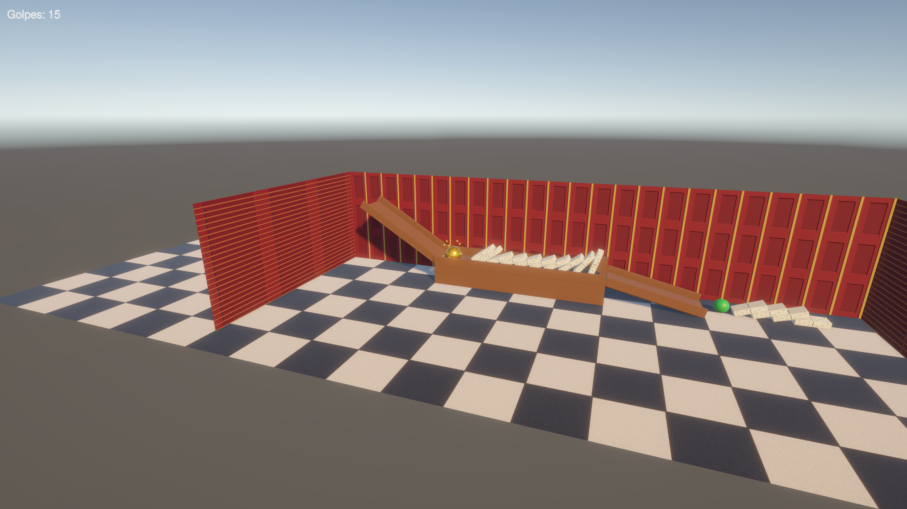

# Taller Rube Goldberg — Unity

Máquina de Rube Goldberg para practicar el motor de físicas de Unity.

- **Unity:** 6000.6.5f1 (Universal 3D / URP)
- **Escena:** `Assets/Scenes/RubeGoldberg.unity` → abrir y dar Play.

## Cadena de eventos (15 golpes)

1. La bola de oro baja por la rampa y golpea la primera ficha.
2. Caen 10 fichas de dominó en cadena (prefab `Ficha`).
3. La última ficha empuja la bola verde desde el pilar.
4. La bola verde baja por la segunda rampa y tumba 4 fichas finales.

El contador en pantalla (`HitCounter.cs`) suma cada par distinto de piezas que chocan.

## Qué se usó

- **Rigidbody + Box/Sphere Collider** en las piezas que se mueven; suelo, rampas y paredes solo con collider.
- **Prefabs:** `Ficha` (dominó) y `Pared` (plano rotado).
- **Materiales:** dominó con textura, normal map y emisión; bola de oro metálica; piso con tiling; pared con normal map.
- **Luz direccional** de atardecer con sombras suaves y **post processing** (Global Volume + Bloom).
- **CameraLookAt.cs:** la cámara queda fija y mira siempre a la bola de oro.
- **Sistema de partículas** como hijo de la bola de oro.

